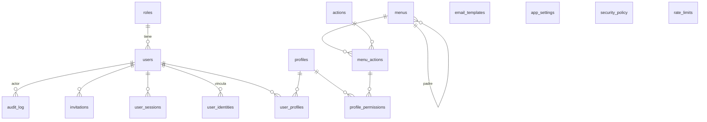

# Spec 01 — Modelo de datos (PostgreSQL)

Estado: **APROBADO** (2026-10-24). Implementado en `supabase/migrations/`.

Decisiones tomadas con la propuesta por defecto (sin objeción del usuario):
- El administrador gestiona solo usuarios cliente; solo el superusuario gestiona administradores y superusuarios (regla por `roles.rank`).
- Registro libre: interruptor `self_registration_enabled`, apagado por defecto; si se enciende, solo crea clientes activos sin perfiles.
- Apellido paterno obligatorio y materno opcional.
- Perfiles base: Gestión de usuarios, Auditor, Consulta.

Ajustes surgidos al implementar (§2 `menus`, §5):
- `menus.superuser_only`: los permisos de menús marcados (y de sus hijos) nunca pueden ir en un perfil.
- Segundo rol de aplicación `app_auth` para los flujos sin sesión.
- RLS sin `FORCE`: las funciones `SECURITY DEFINER` pertenecen al dueño de las migraciones; los roles de aplicación nunca son dueños, así que RLS siempre les aplica.

## Convenciones

- Esquema único `app` (nada en `public`; la Data API de Supabase queda desactivada).
- Nombres en inglés, `snake_case`, tablas en plural.
- PK `uuid` (`gen_random_uuid()`, nativo en PG 13+) salvo catálogos fijos (`smallint`) y auditoría (`bigint identity`).
- Columnas de traza en tablas mantenibles: `created_at`, `created_by`, `updated_at`, `updated_by` (FK a `users`).
- Textos traducibles en `jsonb` `{ "es": "...", "en": "..." }` con `CHECK` de ambas claves.
- Sin borrado físico de usuarios, perfiles ni menús del sistema: se usan `status` / `is_active`.
- Solo SQL estándar de PostgreSQL; sin extensiones fuera de las que trae PostgreSQL (`pgcrypto` solo si hace falta para hashes en BD).

## Diagrama

## 1. Identidad y acceso

### `roles` (catálogo fijo, solo semilla)
| columna | tipo | notas |
|---|---|---|
| id | smallint PK | 1 = superuser, 2 = admin, 3 = client |
| code | text UNIQUE | `superuser`, `admin`, `client` |
| name | jsonb | i18n |
| rank | smallint | menor = más privilegio (para la regla "no otorgar sobre tu nivel") |
| mfa_required | boolean | editable desde Políticas. `CHECK`: siempre `true` para superuser y admin |

### `users`
| columna | tipo | notas |
|---|---|---|
| id | uuid PK | |
| email | text NOT NULL | índice único sobre `lower(email)`: clave para vincular cuentas |
| first_name | text NOT NULL | |
| last_name | text NOT NULL | apellido paterno |
| second_last_name | text | apellido materno |
| rut | text UNIQUE NULL | normalizado `12345678-K`; formato con `CHECK` y dígito verificador validado en una función SQL `app.is_valid_rut()` + `packages/shared` |
| phone | text | E.164 |
| job_title | text | cargo |
| photo_key | text | clave del objeto en S3 privado (no URL) |
| role_id | smallint FK roles | |
| status | text | `invited` \| `active` \| `inactive` (`CHECK`) |
| failed_login_count | int default 0 | |
| locked_until | timestamptz | bloqueo por intentos; `NULL` = desbloqueado |
| must_change_password | boolean | primer ingreso / restablecimiento |
| password_changed_at | timestamptz | para vencimiento |
| mfa_enabled | boolean | espejo del estado en Cognito |
| locale | text NULL | `es`/`en`; NULL = valor de `app_settings` |
| time_zone | text NULL | IANA; NULL = valor de `app_settings` |
| last_login_at | timestamptz | |
| traza | | created/updated at/by |

Restricción **"siempre al menos un superusuario activo"**: trigger `CONSTRAINT TRIGGER ... DEFERRABLE INITIALLY DEFERRED` en `users` que rechaza el commit si no queda ningún `role=superuser AND status='active'`.

### `user_identities` (cuentas vinculadas)
| columna | tipo | notas |
|---|---|---|
| id | uuid PK | |
| user_id | uuid FK users | |
| provider | text | `local` \| `google` \| `facebook` \| `apple` |
| cognito_sub | text UNIQUE | `sub` del usuario en Cognito (mapea token → usuario) |
| provider_subject | text | id del usuario en el IdP externo |
| linked_at, last_used_at | timestamptz | |

`UNIQUE(provider, provider_subject)`. Un email y varios métodos de ingreso dan un solo `users` con N identidades. La vinculación ocurre en el trigger Pre-SignUp de Cognito (`AdminLinkProviderForUser`) y solo si el email del IdP viene verificado.

### `user_sessions`
| columna | tipo | notas |
|---|---|---|
| id | uuid PK | |
| user_id | uuid FK | |
| client_type | text | `web` \| `mobile` |
| origin_jti | text UNIQUE | claim `origin_jti` de Cognito; se valida en **cada request** → revocación inmediata |
| refresh_token_hash | bytea | SHA-256; nunca el token |
| ip | inet | |
| user_agent | text | |
| created_at, last_seen_at, expires_at | timestamptz | `last_seen_at` controla el tiempo de inactividad |
| revoked_at | timestamptz | |
| revoked_by | uuid FK users | |
| revoked_reason | text | `logout`, `admin`, `password_change`, `idle`, `locked` |

### `invitations`
| columna | tipo | notas |
|---|---|---|
| id | uuid PK | |
| user_id | uuid FK | usuario creado en estado `invited` |
| token_hash | bytea UNIQUE | SHA-256 del token aleatorio (el token solo va en el email) |
| expires_at | timestamptz | TTL desde `security_policy` |
| accepted_at, revoked_at | timestamptz | uso único |
| invited_by, created_at | | |

La recuperación de contraseña usa el flujo de Cognito (código), con el email generado desde nuestras plantillas mediante el trigger Custom Message. No necesita tabla.

## 2. Perfiles, menús y permisos

### `profiles`
| columna | tipo | notas |
|---|---|---|
| id | uuid PK | |
| name | text | único sobre `lower(name)` |
| description | text | |
| is_active | boolean | desactivar = sus permisos dejan de sumar |
| traza | | |

### `user_profiles`
PK `(user_id, profile_id)`, más `granted_at` y `granted_by`.

### `menus` (jerárquico: módulo > menú > submenú)
| columna | tipo | notas |
|---|---|---|
| id | uuid PK | |
| parent_id | uuid FK menus NULL | |
| kind | text | `module` \| `menu` \| `submenu`; un trigger valida que el padre sea del nivel anterior |
| code | text UNIQUE | clave estable usada por el backend, p. ej. `security.users` |
| name | jsonb | i18n |
| icon | text | nombre de ícono MDI |
| route | text | ruta web (NULL para módulos) |
| sort_order | int | orden entre hermanos |
| show_in_mobile | boolean | menús visibles en la app del cliente |
| superuser_only | boolean | solo superusuario (módulo Configuración); se hereda a los hijos y no se puede otorgar en perfiles |
| is_system | boolean | menús de la base: no se eliminan ni se cambia su `code` |
| is_active | boolean | |
| traza | | |

### `actions` (catálogo de acciones)
| columna | tipo | notas |
|---|---|---|
| id | smallint PK | |
| code | text UNIQUE | estándar: `view`, `create`, `edit`, `delete`, `export`; especiales: `unlock`, `reset_password`, `revoke_sessions`… |
| name | jsonb | i18n |
| is_standard | boolean | estándar = columna fija de la matriz |
| sort_order | int | |

### `menu_actions` (acciones disponibles en cada menú = **permiso**)
| columna | tipo | notas |
|---|---|---|
| id | uuid PK | |
| menu_id | uuid FK menus | |
| action_id | smallint FK actions | |

`UNIQUE(menu_id, action_id)`. La clave del permiso es `"<menu.code>:<action.code>"`, p. ej. `security.users:unlock`.

### `profile_permissions`
PK `(profile_id, menu_action_id)`, más `granted_at` y `granted_by`.

### Vista `v_user_permissions`
`(user_id, menu_code, action_code)`: suma de permisos de los perfiles **activos** del usuario activo. El superusuario recibe implícitamente todos los permisos. El backend la consulta en cada request (sin caché), así que un permiso quitado aplica en la siguiente request.

## 3. Configuración (solo superusuario)

### `app_settings` (fila única: `id boolean PK DEFAULT true CHECK (id)`)
`system_name`, `logo_key` (S3), `primary_color`, `secondary_color` (`CHECK` hex), `default_locale`, `default_time_zone`, `self_registration_enabled` (default `false`), `updated_at`, `updated_by`.

### `security_policy` (fila única)
| columna | default | restricción |
|---|---|---|
| password_min_length | 12 | `>= 12` (ASVS 2.1.1) y `<= 128` |
| password_require_upper / lower / digit / symbol | true | |
| password_max_age_days | 0 | 0 = no vence |
| max_failed_attempts | 5 | 3–10 |
| lockout_minutes | 15 | `> 0` |
| idle_timeout_minutes | 15 | 5–120 |
| session_max_hours | 12 | |
| invitation_ttl_hours | 72 | 1–168 |
| updated_at, updated_by | | |

El MFA por rol vive en `roles.mfa_required`, que se edita desde esta misma pantalla. Al guardar, el backend sincroniza la política de contraseña del User Pool de Cognito.

### `email_templates`
`id`, `code` (`invitation` \| `activation` \| `password_reset` \| `account_locked`), `locale` (`es` \| `en`), `subject`, `body_html`, `body_text`, traza. `UNIQUE(code, locale)`. Las variables permitidas por plantilla (`{{first_name}}`, `{{link}}`, `{{expires_at}}`, `{{system_name}}`…) quedan definidas en `packages/shared` y se validan al guardar; el HTML se sanitiza.

## 4. Seguridad operacional

### `rate_limits`
`key text` (`ip:1.2.3.4:login`, `user:<id>:login`), `window_start timestamptz`, `hits int`, PK `(key, window_start)`. Complementa la regla por IP del WAF. Un job de limpieza borra ventanas vencidas.

### `audit_log` (inmutable)
| columna | tipo | notas |
|---|---|---|
| id | bigint identity PK | |
| occurred_at | timestamptz default now() | |
| actor_user_id | uuid NULL | NULL para eventos anónimos (login fallido) |
| actor_email | text | copia al momento del evento |
| event_type | text | `auth.login.success`, `auth.login.failure`, `auth.locked`, `user.update`, `profile.permissions.update`, `config.security_policy.update`… |
| entity_type, entity_id | text | |
| result | text | `success` \| `failure` |
| ip | inet | |
| user_agent | text | |
| request_id | text | correlación con CloudWatch |
| old_value, new_value | jsonb | sin contraseñas ni tokens (se filtran antes de insertar) |
| prev_hash, hash | bytea | cadena SHA-256 que permite detectar alteraciones |

Inmutabilidad: el rol de aplicación solo tiene `INSERT, SELECT`, y un trigger rechaza `UPDATE/DELETE/TRUNCATE` para cualquier rol. Se agrega un índice por `(occurred_at)`, `(actor_user_id, occurred_at)` y `(event_type, occurred_at)`.

## 5. Roles de base de datos y RLS

| rol | uso | permisos |
|---|---|---|
| dueño de migraciones | migraciones | dueño del esquema, tablas y funciones `SECURITY DEFINER` |
| `app_api` | Lambdas autenticadas (LOGIN por entorno, SSL obligatorio) | DML por columna sobre tablas de negocio; solo `INSERT/SELECT` en `audit_log`; sin DDL ni `DELETE` de usuarios |
| `app_auth` | flujos sin sesión (triggers de Cognito, login fallido, invitaciones) | lectura de identidad y configuración; vincular identidades; activar invitados; bloqueo vía funciones |

Contexto por transacción: el backend ejecuta `select set_config('app.user_id', '<uuid>', true)` en cada request. Funciones `SECURITY DEFINER STABLE`: `app.is_superuser()`, `app.has_permission()`, `app.can_manage_role()`, `app.can_grant_profile()`, `app.can_grant_menu_action()`, `app.current_permissions()`. Bloqueo: `app.register_login_failure()`, `app.register_login_success()`, `app.is_locked()`.

RLS activada en todas las tablas (sin `FORCE`; ver ajustes arriba):

| tabla | lectura | escritura |
|---|---|---|
| users | fila propia, o `security.users:view` | `security.users:create/edit`; admin solo sobre usuarios `client` |
| user_profiles | propia, o `security.users:view` | `WITH CHECK`: superusuario, o el actor posee **todos** los permisos del perfil |
| profile_permissions | `security.profiles:view` | `WITH CHECK`: superusuario, o el actor posee ese `menu_action` (**admin no otorga lo que no tiene**) |
| user_sessions | propias, o `security.users:view` | propias, o `security.users:revoke_sessions` |
| app_settings, security_policy, menus, actions, menu_actions, email_templates | todo usuario autenticado (lo necesita para pintar menú y tema) | solo superusuario |
| audit_log | `security.audit:view` | `INSERT` por el backend |

Las reglas críticas se validan en el backend (primera capa) **y** en RLS/triggers (segunda capa), y ambas tienen prueba.

## 6. Semilla (`seed.sql`)

- Roles: superuser, admin, client.
- Acciones estándar y especiales.
- Menús base:
  - **Seguridad** (módulo): Usuarios (`security.users`: ver, crear, editar, exportar, unlock, reset_password, revoke_sessions), Perfiles (`security.profiles`: ver, crear, editar, eliminar=desactivar, exportar), Auditoría (`security.audit`: ver, exportar).
  - **Configuración** (módulo, solo superusuario): Parámetros, Menús, Políticas de seguridad, Plantillas de email.
  - "Mi cuenta" no es un permiso: está disponible para todo usuario autenticado.
- Perfiles base: **Gestión de usuarios** (usuarios + ver perfiles), **Auditor** (auditoría ver/exportar), **Consulta** (solo `view`).
- `app_settings`, `security_policy` y las 8 plantillas de email (4 × es/en) con valores por defecto.
- Superusuario inicial: en local, `superadmin@local.test`; en dev/prod, un script de instalación recibe el email por parámetro y crea el usuario en Cognito y en `users`.

## Fuera de la BD (para claridad)

- Contraseñas y factores MFA: **solo en Cognito**.
- Fotos y logo: bucket S3 privado con URLs prefirmadas (Supabase Storage no se usa).
- Envío de emails: Amazon SES.
