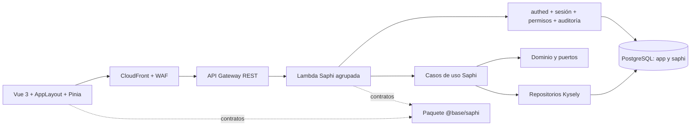

# Saphi Chile — 01. Arquitectura

Estado: **PROPUESTA DE FASE 1 — pendiente de aprobación**. Fecha: 2026-10-27.
Antecedente: [auditoría](./00-auditoria-base-fairplay.md), aprobada con observaciones por el responsable. Su estado y resultados corresponden a ese momento; no se reescribe como evidencia nueva.

## Decisiones aprobadas por el responsable

| ID | Decisión y alcance |
|---|---|
| A01 | Extender Base Fairplay como plataforma transversal; mantener Vue 3, Node 24, TypeScript y AWS |
| A02 | Reutilizar autenticación, sesiones, usuarios, permisos y auditoría |
| A03 | Diseñar esquema PostgreSQL independiente `saphi`, sin migraciones en esta fase |
| A04 | Diseñar paquete compartido `@base/saphi` |
| A05 | Una Lambda Saphi agrupada inicialmente |
| A06 | PostgreSQL nativo como alternativa inicial de telemetría |
| A07 | Evaluar PostGIS sin instalar; TimescaleDB solo si se justifica |
| A08 | Fase 1 exclusivamente documental; sin funcionalidades agrícolas, herramientas nuevas ni despliegues |

Las decisiones nuevas se etiquetan R (recomendación) o Q (pregunta) en el [resumen ejecutivo](./08-resumen-ejecutivo.md). Este documento no aprueba reglas agronómicas ni proveedores.

## Arquitectura lógica y componentes



La frontera pública sigue siendo mismo origen, `/api/*`; los recursos registrados en API Gateway omiten ese prefijo. No hay nuevo login, directorio de usuarios, sesión, matriz global de roles ni servicio de auditoría paralelo.

| Componente | Responsabilidad | Dependencias permitidas |
|---|---|---|
| Adaptador HTTP | Parsear, autenticar, autorizar, invocar caso de uso y mapear DTO/errores | Base Fairplay, contratos y aplicación |
| Aplicación | Orquestación, unidad de trabajo, autorización contextual y auditoría administrativa | Dominio y puertos; transacción suministrada desde composición |
| Dominio | Entidades, invariantes y reglas documentadas | TypeScript; contratos puros cuando sean necesarios |
| Persistencia | Consultas parametrizadas, mapeos e integridad en PostgreSQL | Kysely/pg, puertos y transacción autorizada |
| Integraciones | Validación de identidad externa y traducción de datos | Puertos, SDK del proveedor solamente en adaptadores futuros |
| Web Saphi | Flujo agrícola, filtros, estado de empresa y presentación | Servicios HTTP base, contratos y UI base |
| `@base/saphi` | DTO, claves, errores, tipos y validadores compartidos | `@base/shared`; sin AWS, Vue, Kysely, pg ni secretos |

No introducir un contenedor DI. Componer por funciones como [Deps](../../apps/api/src/lib/deps.ts). Los repositorios reciben el `tx` ya autorizado; no abren otra conexión y no importan handlers. El dominio no importa tipos Lambda ni PostgreSQL. No exportar infraestructura por el paquete compartido.

## Separación de dominios

| Dominio propietario | Datos / capacidad | Consulta de otros dominios |
|---|---|---|
| companies + tenancy | Empresas, membresías y asignación contextual de permisos existentes | Identidad de `app.users`; no modificar usuarios globales |
| farms | Predios | Empresa autorizada |
| plots + geo | Cuarteles, ubicación, geometría y puntos de muestreo | Predios por puerto de consulta |
| soil-samples | Toma y trazabilidad de muestras | Cuarteles/puntos |
| laboratory | Resultados y métodos documentados | Muestras |
| devices | Registro y vínculo de dispositivos | Cuarteles |
| telemetry | Mediciones, deduplicación, últimos valores e históricos | Identidad resuelta por devices |
| satellite | Observaciones e índices de fuente externa | Cuarteles y puerto de objetos |
| irrigation | Eventos y fuente de datos | Cuarteles |
| indicators | Ejecución de estrategias aprobadas/versionadas | Puertos de lectura; no escritura ajena |
| dashboard | Proyecciones de lectura consolidadas | Consultas autorizadas; no fórmulas nuevas |

Dirección de dependencia: dashboard → indicadores/lecturas; indicadores → puertos de lecturas; laboratorio → muestras; telemetría → identidad de dispositivo; maestros → empresa. Los dominios no importan repositorios internos de otros dominios. Las lecturas compuestas se implementan como consultas de aplicación explícitas, con el mismo ámbito empresarial y pruebas. Prohibir ciclos mediante revisión de imports y un chequeo de grafo cuando se implemente, sin instalar herramientas ahora.

## Organización prevista

```text
apps/api/src/saphi/
  index.ts, routes.ts, composition.ts
  tenancy/
  companies/, farms/, plots/, geo/, soil-samples/, laboratory/
  devices/, telemetry/, satellite/, irrigation/, indicators/, dashboard/
  integrations/iot/, integrations/satellite/
  <dominio>/routes.ts
  <dominio>/application/, domain/, infrastructure/
apps/api/test/saphi/
apps/web/src/modules/saphi/
  routes.ts, services/, stores/, components/
  companies/, farms/, plots/, maps/, laboratory/, devices/
  telemetry/, satellite/, irrigation/, indicators/, dashboard/
apps/web/test/saphi/
packages/saphi/src/
  index.ts, contracts/, schemas/, types/, constants/
packages/saphi/src/**/*.test.ts
supabase/migrations/<nueva_migracion>.sql
supabase/tests/<nuevo_test_saphi>.test.sql
```

Árbol objetivo, no orden de creación masiva. Los globs existentes descubren pruebas de API/web bajo `test/`; crear solo carpetas con contenido útil. Los futuros manifiestos y configuración del paquete se basarán en `@base/shared`. R01: usar Zod ya presente en la API como dependencia explícita del paquete, sujeto a aprobación del cambio de manifiestos en Fase 2. No trasladar contraseñas ni utilidades globales a Saphi.

## Integración transversal y despliegue

- Conservar [authed](../../apps/api/src/lib/authenticate.ts) y el autocommit previo de `app.authenticate()`. Agregar composición de autorización empresarial en Saphi sobre su transacción. [Seguridad](./03-seguridad.md) define la intersección de capacidades globales y asignaciones por empresa.
- Conservar catálogo `app.menus/actions/menu_actions`, `app.profiles/profile_permissions` y `app.v_user_permissions`. La nueva relación contextual referencia `menu_actions`, no crea otro catálogo de permisos.
- Conservar [auditoría](../../apps/api/src/lib/audit.ts). No exponer la consulta global a gestores agrícolas.
- Reutilizar `AppLayout`, guards, HTTP, notificaciones, i18n y componentes compartidos; completar autorización contextual aparte de la navegación global.
- Futuro despliegue: una función Saphi en el mismo servicio y stage, rol IAM mínimo, secreto de BD para `app_api`, sin acceso a credenciales de `app_auth`. Evaluar presión sobre conexiones antes de aumentar concurrencia.
- Registrar rutas en Serverless y servidor local; incluir nueva entrada en `bundle-check`. Migraciones nuevas preceden a la activación de rutas que dependan de ellas. No publicar endpoints parcialmente autorizados.
- Despliegue manual autorizado por ambiente; compatibilidad aditiva, pruebas de regresión y plan de recuperación. Rollback de código debe tolerar columnas/tablas nuevas; no borrar datos mediante down migrations automáticas.
- Objetos y trabajadores asíncronos son diseño futuro de [integraciones](./06-integraciones.md), no recursos aprobados. No modificar buckets actuales para convertirlos en almacenamiento agrícola sin evaluación.

## Límites y decisiones arquitectónicas propuestas

R02: autorización efectiva = capacidad global ∩ permiso asignado en empresa activa ∩ membresía activa; sin herencia implícita de permisos globales sobre datos tenant. R03: superusuario sujeto a membresía para datos; bootstrap administrativo estrecho. R04: PostgreSQL nativo inicialmente sin particionado hasta medir volumen. R05: geometría opcional hasta resolver PostGIS; no fingir validación topológica.

Son propuestas sujetas a aprobación. Reglas agronómicas, autoridad para bootstrap, proveedor de BD, esquemas de mensajes y bibliotecas de visualización siguen pendientes. La aceptación de Fase 1 es la aprobación de estas especificaciones; iniciar Fase 2 exige autorización independiente y alcance explícito según [criterios](./07-pruebas.md).
