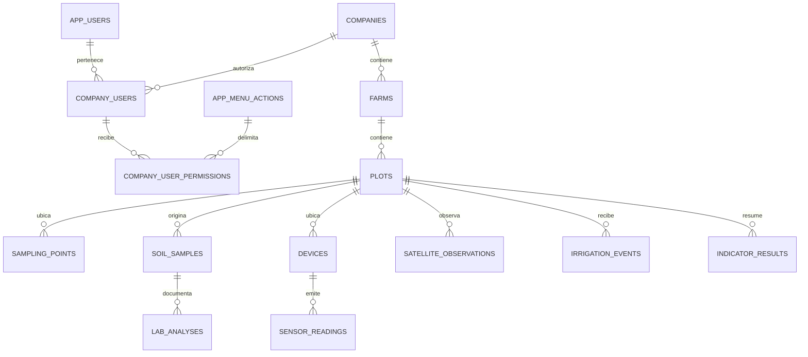

# Saphi Chile — 02. Modelo de datos

Estado: **PROPUESTA DE FASE 1 — pendiente de aprobación**. No contiene migraciones ejecutables ni implica creación de objetos. Esquema `saphi` y PostgreSQL nativo aprobados para diseño; tipos, restricciones y asignación contextual siguientes son recomendaciones técnicas.

Referencias: [arquitectura](./01-arquitectura.md), [seguridad](./03-seguridad.md), [API](./04-api.md).

## Convenciones y relaciones

PK `uuid` generado en servidor, salvo claves compuestas expresas. Toda tabla empresarial incluye `company_id uuid NOT NULL`; `companies` es la raíz y utiliza su propio `id`. `created_at`, `updated_at`: `timestamptz`; `created_by`, `updated_by`: FK a `app.users`, con null solo para orígenes de integración expresamente documentados. No inventar un usuario técnico humano para ingesta. Fechas de negocio se guardan separadas de fechas de recepción. Instantes en UTC; zona de visualización empresarial por definir, sin alterar el instante original.

R06: no borrar empresas ni registros de medición desde el CRUD inicial. Estados y correcciones conservan trazabilidad; retención/purga se diseña por separado. Estado inicial para maestros: `active|inactive`, recomendación de ciclo técnico, no una clasificación agronómica. Códigos estables de negocio son únicos dentro de la empresa. Texto de nombre 1..200 caracteres; código 1..64; notas hasta 2000. Límites propuestos a confirmar en contrato, sin HTML. Validaciones SQL y API coherentes; no confiar solo en formularios.

Los nombres abreviados del diagrama son lógicos. Las tablas concretas se enumeran a continuación.

## Diccionario propuesto

| Tabla en `saphi` | Claves y columnas de negocio | Restricciones y relaciones |
|---|---|---|
| `companies` | `id` PK; `rut`, `legal_name`, `trade_name?`, `contact_email?`, `contact_phone?`, `status`, `version` | RUT canónico validado con helper existente, UNIQUE global propuesto; confirmar tratamiento de entidades sin RUT. Email ≤254, teléfono ≤40. `version bigint > 0` |
| `company_users` | PK `(company_id,user_id)`; `status`, `version`, metadatos de concesión/revocación | FK empresa y `app.users`; nunca FK a identidad Cognito. No campo contraseña ni rol empresarial nuevo |
| `company_user_permissions` | PK `(company_id,user_id,menu_action_id)`; `granted_by`, `granted_at` | FK compuesta a membresía; FK a `app.menu_actions`; solo catálogo Saphi permitido por función de concesión; sin permisos definidos por texto libre |
| `farms` | `id`, `company_id`, `code`, `name`, `area_ha?`, `location?`, `status`, `version` | UNIQUE `(company_id,id)` y `(company_id,code)`; área decimal positiva cuando se informa; ubicación punto validado |
| `plots` | `id`, `company_id`, `farm_id`, `code`, `name`, `area_ha?`, `grape_variety?`, `planting_year?`, `soil_type?`, `geometry?`, `status`, `version` | FK `(company_id,farm_id)` a farms; UNIQUE `(company_id,id)` y `(company_id,code)`; año entero 1..9999, sin prohibir plantaciones futuras hasta regla aprobada |
| `sampling_points` | `id`, `company_id`, `plot_id`, `code`, `location`, `status`, `version` | FK compuesta a plots; UNIQUE `(company_id,id)`, `(company_id,plot_id,id)` y `(company_id,code)` |
| `soil_samples` | `id`, `company_id`, `plot_id`, `sampling_point_id?`, `code`, `sampled_at`, `notes?`, `version` | FK compuesta a plot; FK `(company_id,plot_id,sampling_point_id)` a sampling_points si presente; UNIQUE `(company_id,id)`, `(company_id,code)` |
| `physicochemical_analyses` | `id`, `company_id`, `sample_id`, `analyzed_at`, `laboratory_reference`, `method_reference`, `results`, `supersedes_id?` | FK compuesta a muestra; results según catálogo aprobado, no JSON libre sin esquema; FK compuesta de corrección a la misma tabla; preservar original |
| `microbiological_analyses` | Igual estructura de trazabilidad que fisicoquímicos | Tabla separada por tipo de análisis; catálogos y unidades propios pendientes, sin rangos inventados |
| `devices` | `id`, `company_id`, `plot_id`, `code`, `provider_code`, `external_device_id`, `status`, `metadata`, `version` | FK compuesta a plot; UNIQUE `(company_id,id)`, `(company_id,code)`; identidad externa resuelta dentro de cuenta de proveedor verificada |
| `sensor_readings` | `id`, `company_id`, `device_id`, `source_message_id`, `sample_index`, `metric_code`, `value`, `unit_code`, `observed_at`, `received_at`, `quality_code?`, `payload_hash` | FK compuesta a device; timestamp finito y valor decimal finito; identidad idempotente descrita abajo; unidad/catálogo pendientes |
| `satellite_observations` | `id`, `company_id`, `plot_id`, `provider_code`, `source_observation_id`, `acquired_at`, `received_at`, `indices`, `asset_refs`, `provenance` | FK compuesta a plot; UNIQUE `(company_id,plot_id,provider_code,source_observation_id)`; archivos por referencia opaca validada |
| `irrigation_events` | `id`, `company_id`, `plot_id`, `started_at`, `ended_at?`, `amount`, `unit_code`, `source_code`, `source_reference?`, `supersedes_id?` | FK compuesta a plot; fin ≥ inicio; cantidad decimal finita ≥0 (cero no prueba riego efectivo); unidad aprobada obligatoria |
| `indicator_results` | `id`, `company_id`, `plot_id`, `indicator_code`, `strategy_version`, `period_from`, `period_to`, `input_fingerprint`, `value`, `unit_code`, `computed_at`, `provenance` | FK compuesta a plot; período no vacío; unicidad por empresa, cuartel, indicador, versión, período y fingerprint; sin estrategia aprobada no calcular |

Las tablas con `id` y referencias empresariales añaden UNIQUE `(company_id,id)` aunque exista PK global: es el destino de FKs compuestas. Referencias de corrección también deben conservar muestra/cuartel compatible, mediante claves adicionales o función de escritura validada. No usar ON DELETE CASCADE sobre datos agrícolas/auditoría. Para filas de concesión puede usarse eliminación explícita autorizada, conservando evento de revocación en auditoría.

`results`: lista estructurada de `{parameterCode,value,unitCode,methodReference?}`; tipo y precisión de cada valor dependen del catálogo. No aprobar una lista de parámetros por incluir este formato. `metadata` es un objeto JSON con esquema acotado, máximo recomendado 4 KiB; no admite secretos. Las cargas completas están sujetas al límite HTTP base de 16 KiB. Precisión propuesta de superficie `numeric(14,4)`; mediciones/cantidades `numeric` con precisión definida por contrato de magnitud. En API los decimales viajan como cadenas para evitar redondeo implícito en JavaScript.

## Permisos diferenciados por empresa

Las definiciones siguen en `app.menu_actions` y los perfiles globales son el techo de capacidad. La relación `company_user_permissions` aporta **alcance empresarial** a esas definiciones, no otro catálogo ni roles nuevos. Se requiere una fila activa en `company_users` y una concesión concreta en la empresa además del permiso global efectivo. Eliminar/desactivar un perfil global retira el techo aunque persista la concesión contextual; reactivarlo vuelve a habilitar esa concesión si la membresía sigue activa. Este comportamiento debe aprobarse y mostrarse a operadores.

R07: concesiones por usuario al inicio, sin perfiles empresariales nuevos. Ventaja: revocar o diferenciar A/B sin cambiar perfiles de todos los usuarios. Costo: mayor administración; si se requieren plantillas por empresa, extender asignaciones con las mismas definiciones en otra fase. La alternativa de asignar perfiles empresariales necesita además resolver que `app.user_profiles` ya es global; no se adopta implícitamente.

Concurrencia: maestros y membresías usan `version` incremental y PATCH con `expectedVersion`; conflicto →409. Sustitución de permisos bloquea la fila de membresía y aumenta esa versión en la misma transacción. Las funciones de escritura verifican permiso efectivo y alcance de actor/destinatario y conservan auditoría. No escribir tabla de concesiones directamente desde un handler genérico.

## Telemetría, índices y retención

R08: tabla nativa no particionada inicialmente. Índices `(company_id,device_id,observed_at DESC,id DESC)` y `(company_id,device_id,metric_code,observed_at DESC,id DESC)`. Maestros por empresa y código; hijos por `(company_id,parent_id)`; muestras por empresa/cuartel/fecha (nombre de columna `plot_id`). Evitar índices no motivados por consultas.

Clave idempotente propuesta: `(company_id,device_id,source_message_id,sample_index)`. `sample_index` identifica una medición estable dentro del mensaje y no se deriva del orden variable de procesamiento. Igual clave + hash canónico igual → duplicado aceptado sin otra fila; igual clave + contenido distinto → conflicto, sin sobrescritura. Proveedor sin ID estable requiere otra estrategia aprobada; un timestamp solo no basta. La identidad de cuenta/proveedor resuelve dispositivo y empresa antes de insertar. Evitar reasignar dispositivos entre empresas; reemplazo de registro con nueva identidad interna y trazabilidad.

Consultar por intervalos semiabiertos `[from,to)` y último valor por dispositivo/magnitud, no último paquete por hora de recepción. Sin retención aprobada no programar purgas. Futura partición exige que las claves únicas incluyan clave de partición; revisar deduplicación con un ledger no particionado si necesita identidad global. No adoptar TimescaleDB sin volumen, compatibilidad, operación y costos justificados.

La vinculación autenticada de cuenta/proveedor requiere un modelo técnico adicional antes de habilitar ingesta: candidato `provider_accounts` (id, provider_code, referencia opaca de credencial, estado) y `device_bindings` (provider_account_id, external_device_id, company_id, device_id, binding_version, estado). Unicidad de identidad activa por cuenta/dispositivo externo y FK compuesta al dispositivo interno. Sin secretos en tablas ni acceso web al registro técnico; si una cuenta sirve a varias empresas, cada binding fija una sola empresa y la política del adaptador limita su uso. Son entidades de integración pendientes de Q05, fuera del CRUD maestro inicial; no adoptar una unicidad global de external_device_id que mezcle cuentas. API16 permite registrar metadatos del dispositivo, pero no crea ni activa automáticamente este vínculo de confianza.

## Evaluación geoespacial

PostGIS **no instalado ni aprobado para adopción**. Q04: confirmar versión de PG17 y catálogo de extensiones del servicio real y de la imagen local; comprobar soporte de la versión concreta antes de decidir. Consultas de catálogo y ensayo de instalación pertenecen a una actividad posterior autorizada. La política base de extensiones requiere una excepción documentada si se adopta.

| Alternativa | Alcance y validaciones | Limitación |
|---|---|---|
| PostGIS candidato | geometry con SRID 4326 para intercambio; índices GiST; validación topológica; cálculo de área mediante geografía/proyección acordada | Requiere compatibilidad, privilegios y paridad de ambientes comprobados |
| JSONB GeoJSON candidato | Validar tipo Point/Polygon, estructura, cierre de anillos, finitud, longitud [-180,180], latitud [-90,90]; excluir GeometryCollection inicialmente | Estructura válida no garantiza topología; no prometer contención, superficies ni índices espaciales |

R09: permitir predios/cuarteles sin geometría hasta aprobar solución GIS; no fijar storage definitivo por accidente en el esqueleto. El contrato público GeoJSON será independiente de la representación SQL. Propuesta: máximo 200 vértices por polígono y 16 KiB totales HTTP; multipartes, reproyección, intersecciones, antimeridiano y área oficial se especificarán con requisitos reales. No comparar área informada con polígono sin tolerancia y método aprobados.

## Migraciones futuras

1. Revisar versión/privilegios y entorno descartable. Nuevas migraciones cronológicas para esquema, tablas y helpers; ninguna modificación histórica.
2. Crear catálogo Saphi en tablas existentes sin otorgar permisos por defecto a perfiles globales. Agregar alcance contextual y FK/índices.
3. RLS y grants en la misma migración que expone cada tabla; no ventana temporal de acceso sin políticas. `app_auth` sin acceso Saphi; `app_api` sin propiedad/BYPASSRLS.
4. Datos requeridos mediante migraciones idempotentes en su efecto controlado; semillas solo para fixtures locales. Bootstrap productivo por procedimiento explícito auditado, nunca con credenciales locales.
5. pgTAP y replay desde cero, actualización desde la base existente, pruebas API y compatibilidad de rollback de código. No deshacer migraciones borrando datos.

Ningún paso se ejecuta en Fase 1. Incertidumbres: proveedor BD, retención, identidades IoT, catálogos, reglas RUT excepcionales, precisión de unidades, GIS y autoridad de administración.
